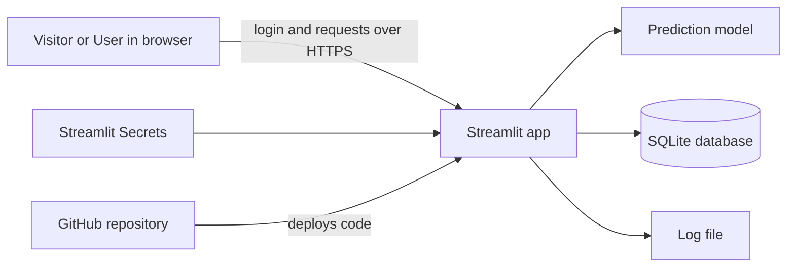

# Threat Model

**Project:** Student Performance Predictor
**Course:** Secure Software Engineering
**Group:**| **Members:** [Anand], [Rupesh]
**Version:** 1.0 (draft) | **Date:** 18 November 2026
**Branch:** secure-se-improvements

This threat model is based on a review of the real source code (Phase 1 audit). Mitigation status is either **Existing** (already in the live app) or **Planned** (to be built and tested in this project).

---

## 1. What we are protecting (assets)

| Asset | Why it matters |
|---|---|
| Student records (names, marks, attendance, study hours) | Private academic information. Currently synthetic, but the design must be safe for real data. |
| User passwords and password hashes (planned) | If stolen, accounts can be taken over. |
| Application availability | The app must stay usable for its users. |
| Source code and GitHub repository | Whoever controls the code controls the live app. |
| Trained model file (`model.pkl`) | A tampered model can give wrong predictions or run harmful code. |
| Secrets (Streamlit Secrets, planned) | Needed to log in and run the app safely. |

## 2. Who might attack (actors)

| Actor | Description | Skill |
|---|---|---|
| Anonymous visitor | Finds the public link and clicks around | Low |
| Curious or dishonest student | Wants to see other students' marks or change their own | Low to medium |
| Logged-in User trying to become Admin | Tries to reach Admin features | Medium |
| Outside attacker | Tries guessing passwords or sending harmful input | Medium |
| Accidental mistake | A group member commits a secret or breaks a setting | Not an attacker, but a real risk |

## 3. System overview and trust boundaries

**Trust boundaries (places where data crosses from untrusted to trusted):**
1. Browser to Streamlit app: everything typed by a person is untrusted.
2. CSV file to database: file content is untrusted until validated.
3. GitHub repository to the live app: whoever can change the repository can change the live app.

## 4. STRIDE: six kinds of threats

| Letter | Name | Simple example for this project |
|---|---|---|
| S | Spoofing | Pretending to be another person, such as logging in as Admin |
| T | Tampering | Changing data that should not be changed, such as sending harmful input |
| R | Repudiation | Doing something and then denying it, with no log to prove it |
| I | Information disclosure | Seeing data you should not see, such as all student records |
| D | Denial of service | Making the app too busy or broken to use |
| E | Elevation of privilege | A normal User gaining Admin power |

## 5. Threat list with risk ratings

Likelihood and impact are each rated Low, Medium or High. Risk is the combination.

| ID | Threat | STRIDE | Likelihood | Impact | Risk |
|---|---|---|---|---|---|
| T1 | Anyone with the link can use the whole app (no login) | S, E | High | Medium | **High** |
| T2 | Anyone can view all student records and download the CSV | I | High | High | **High** |
| T3 | Attacker guesses passwords by trying many times | S | Medium | High | **High** |
| T4 | Passwords stored in readable form and stolen | I | Low | High | **Medium** |
| T5 | SQL injection through text sent to the database | T, I | Low | High | **Medium** |
| T6 | Harmful or impossible values (negative hours, huge marks, odd names) reach the model or database | T | Medium | Medium | **Medium** |
| T7 | A CSV file with bad rows is loaded without checking | T | Medium | Medium | **Medium** |
| T8 | Error messages reveal file paths or internal details | I | Medium | Medium | **Medium** |
| T9 | A secret is accidentally uploaded to the public GitHub repository | I | Medium | High | **High** |
| T10 | Unpinned or vulnerable packages break the app or add weaknesses | T, D | Medium | Medium | **Medium** |
| T11 | GitHub account takeover or a tampered `model.pkl` changes what the live app runs | T, E | Low | High | **Medium** |
| T12 | A User changes the page state or interface to reach Admin features | E | Medium | High | **High** |
| T13 | No record of who did what, or logs that contain personal data | R, I | Medium | Low | **Low** |
| T14 | Heavy use makes the free-hosted app slow or unavailable | D | Low | Low | **Low** |

## 6. Mitigations

| Threat | Planned or existing mitigation | Status |
|---|---|---|
| T1 | Login required before any feature; logout clears the session | Planned |
| T2 | Role-based access: only Admin sees records and downloads CSV | Planned |
| T3 | Delay after repeated failed logins; same message for wrong username or wrong password | Planned |
| T4 | Hash passwords with bcrypt or Argon2id; never log or store plain passwords | Planned |
| T5 | Parameterized queries everywhere; automated test with a harmless injection sample | Existing, test planned |
| T6 | Range checks in the `Student` class (existing); name checks and validation inside the prediction function (planned) | Partly existing |
| T7 | Validate every CSV row with the `Student` rules before storing | Planned |
| T8 | Catch errors, show friendly messages, log details privately | Planned |
| T9 | Add secret files to `.gitignore`; store secrets in Streamlit Secrets; search the repository before each push | Planned |
| T10 | Pin package versions; scan with pip-audit | Planned |
| T11 | Turn on two-factor login for GitHub; review changes before merging; keep `model.pkl` rebuildable from code | Planned (manual steps) |
| T12 | Check the role in Python code on every page run, never only by hiding buttons; test with unauthorized access | Planned |
| T13 | Log logins, failures and denials without passwords or names | Planned |
| T14 | Accepted risk: handled by the hosting platform's limits; no extra work in this project | Accepted |

## 7. Risks we accept

| Risk | Reason |
|---|---|
| T14 (heavy use) | Free hosting limits apply, and the app is a college project with few users. |
| Data loss when the hosting platform restarts | The database is rebuilt from the CSV file. No real records are stored. |

## 8. Residual risks (what remains after our work)

- The app stores no real student data. If real data is added later, this threat model must be reviewed first.
- Streamlit sessions depend on the hosting platform's security.
- A mistake by a group member can still happen, so every change is reviewed before merging.

## 9. Link to other documents

| Threat | Requirement IDs (SECURITY_REQUIREMENTS.md) |
|---|---|
| T1, T12 | SR-AUTH-1, SR-AUTH-5, SR-AUTHZ-5 |
| T2 | SR-AUTHZ-3, SR-AUTHZ-4 |
| T3 | SR-AUTH-3, SR-AUTH-4 |
| T4 | SR-AUTH-2 |
| T5 | SR-DB-1, SR-DB-2, SR-DB-3 |
| T6, T7 | SR-VAL-1 to SR-VAL-8 |
| T8 | SR-ERR-1, SR-ERR-2 |
| T9 | SR-AUTH-6, SR-DATA-2, SR-CFG-1 |
| T10 | SR-CFG-2, SR-CFG-3 |
| T13 | SR-ERR-3, SR-ERR-4 |
