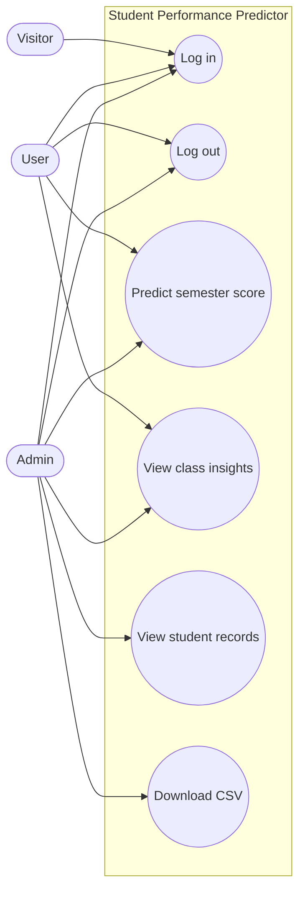
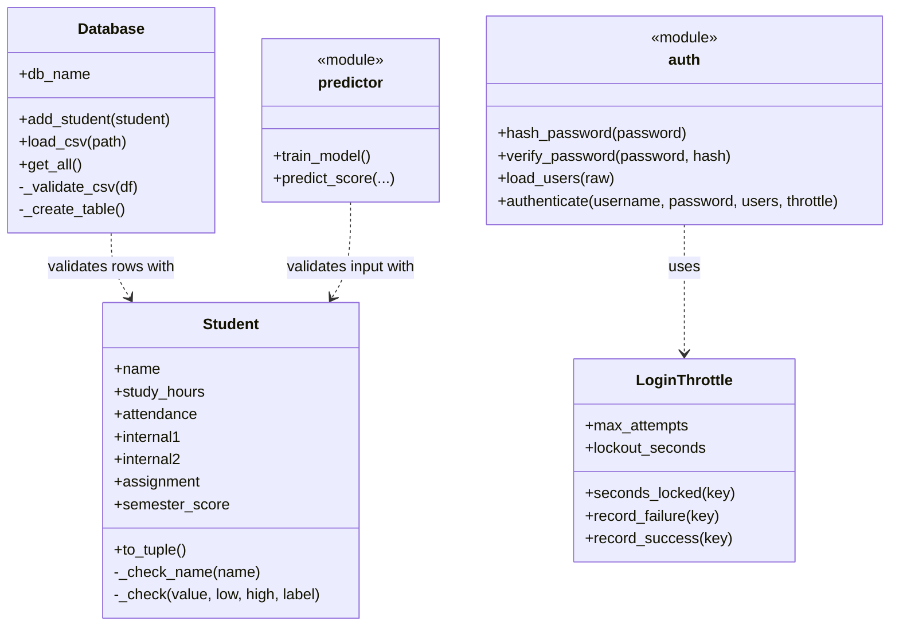
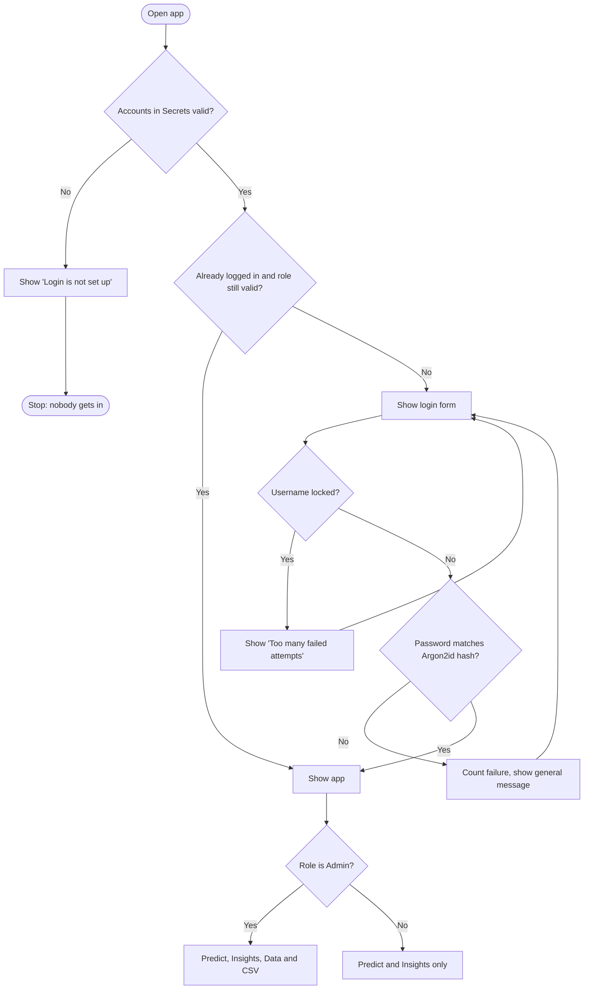
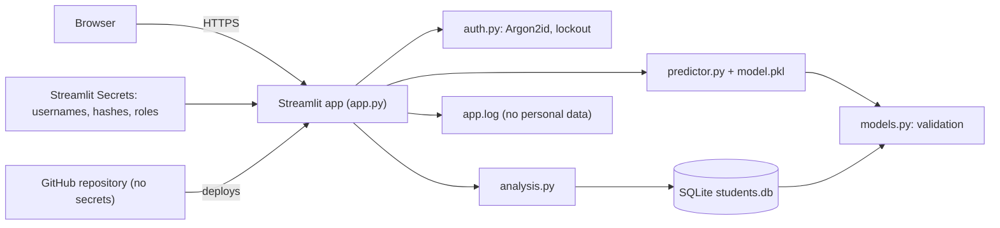

# UML Diagrams

**Project:** Student Performance Predictor (secure version)

GitHub draws these diagrams automatically from the Mermaid code.

## 1. Use case diagram

## 2. Class diagram

## 3. Activity diagram (login and access)

## 4. Architecture diagram

